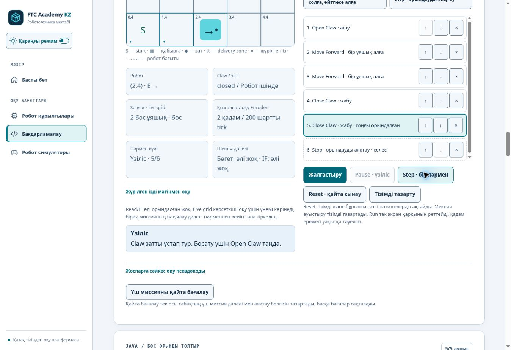

# Final audit corrections — 2026-11-16

Base: `main` at `23a27272d57be4a7832fce59188ed9981d29af06`.
This follow-up fixes the three Low findings FA-01–03 from the final audit. It does not change lessons, grading requirements, routes, theme styles, wiring validation, storage keys or migrations.

## Corrections

| Finding | Route | Small correction |
| --- | --- | --- |
| FA-01 | `/#hardware/wiring` | Keyboard/assistive activation of an individual disconnect returns focus to that cable's stable selection button. The existing bulk-disconnect QA-01 behavior still returns focus to DC Motor. |
| FA-02 | `/#programming/autonomous`, `/#programming/integrated-challenge` | Keyboard deletion returns focus to the first Forward command palette button, including after deleting the last command. |
| FA-03 | `/#programming/integrated-challenge` | Closing an already-closed Claw while carrying an object now explains that the object is still held. The object, movement and mission objective rules are unchanged. |

Focus uses React refs and `useLayoutEffect` after the connection/command count changes. Pending focus is set only by a removal with `event.detail === 0`; ordinary edits and pointer removal do not request focus restoration. There are no focus timeouts or added dependencies.

## Automated verification

- `npm test`: **143/143 passed**, no failed, skipped or cancelled tests.
- `npm run typecheck`: **passed**.
- `npm run build`: **passed**. Main JavaScript: **706.09 kB**, **192.77 kB gzip**. The existing >500 kB chunk warning remains; bundle optimization is outside this correction.
- `git diff --check`: **passed**.
- Added one model regression test for repeated Close: the carried object, Claw, pickup flag, pose, trail, move and tick counters remain consistent; feedback matches the held state; subsequent Stop succeeds. Closing without an object retains the original explanation.
- The Node model tests **do not test DOM focus**. No DOM test framework was added for this small fix.

## Actual browser verification

Desktop Chrome, managed local preview of this branch, 2026-11-16. These are browser observations, separate from model unit tests:

| Reproduction | Observed result |
| --- | --- |
| Wiring: DC Motor → Motor 0 → individual disconnect with Enter | 0/8 connections; active element is DC Motor; visible 2 px focus outline. Tab goes to Motor Encoder. |
| Wiring: DC Motor and Servo Motor connected; disconnect Servo Motor with Enter | Servo Motor receives focus; the DC Motor connection remains (1/8). |
| Wiring: mouse individual disconnect | Connection removed; no programmatic jump to a cable selector. |
| Wiring: ordinary connection | Focus remains on the activated Motor 0 port. |
| QA-01: DC Motor → Motor 0 → bulk disconnect with Enter, Light Mode | 0/8; focus DC Motor; visible 2 px outline; Tab goes to Motor Encoder. |
| QA-01: mouse bulk disconnect | 0/8; no forced selector focus. |
| Lesson 4: add one Forward → delete with Enter, Light Mode | Empty list; focus Forward palette; visible 2 px outline; Tab goes to Turn Left. |
| Lesson 4: mouse-delete sole command | Empty list; no forced palette focus. |
| Lesson 4: add Forward and Turn Left → delete first with Enter, Dark Mode | One command remains; focus Forward palette. |
| Lesson 8: add one Forward → delete with Enter, Dark Mode | Empty list; focus Forward palette; visible 3 px outline; Tab goes to Turn Left. |
| Lesson 8: mouse-delete sole command | Empty list; no forced palette focus. |
| Lesson 8: add/delete Forward with Enter, Light Mode | Focus Forward palette; visible 3 px outline. |
| Mission 1: Open, Forward, Forward, Close, Close, Stop; Step through first five | At (2,4), object carried, Claw closed, 2 moves/200 illustrative ticks; feedback says the object is held, with Stop still pending (5/6). |
| Same sequence, Step Stop | Mission success reported only after Stop. |

The browser log query included extension-origin metadata errors (`chrome-extension://…/content-script.bundle.js`); these are tooling noise, not reported as application defects. The returned entries did not identify an application error. This is not a claim of exhaustive console monitoring.

## Limitations

- This is a focused correction pass, not a repeat of the complete final audit. All existing automated regression tests ran; unrelated lesson UI flows were not manually repeated.
- Actual phones, mobile viewports, touch, screen readers, other browsers and reduced-motion settings were not retested in this pass.
- Keyboard and pointer focus were observed in a real browser; assistive-technology activation is handled by the same zero-detail event path but was not tested with a screen reader.
- Browser verification used the local development preview. A Vercel deployment status does not substitute for repeating these interactions on that hosted build.
- No physical FTC hardware or FTC SDK Java compilation was involved.
