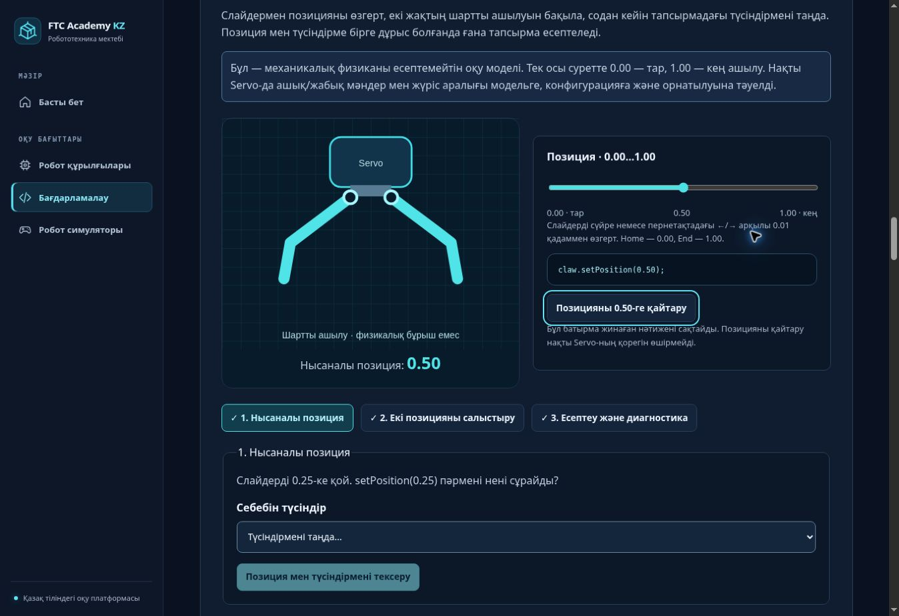

# FTC Academy KZ: бес Programming сабағына арналған мұғалім нұсқаулығы

Жаңартылған күні: 15.11.2026. Нысаналы топ — 9-сыныптың бастапқы деңгейдегі оқушылары. Команда, айнымалы және цикл туралы бастапқы түсінік жеткілікті; веб-тапсырмалар үшін физикалық робот қажет емес.

Бұл бес сабақ — FIRST Tech Challenge (FTC — робототехника жарысы) бағдарламалауын таныстыратын кіріспе білім беру ресурсы. Олар толық ресми FTC оқу бағдарламасы болып саналмайды. Сайттағы оқу үлгілері нақты роботқа қосылмайды, Java кодын құрастырмайды және мотор физикасын есептемейді.

## Сабақтарды жоспарлау

| Сабақ | Нысаналы топ | Оқу мақсаттары | Күтілетін нәтижелер | Оқыту әдістері | Интерактивті әрекеттер | Бағалау өлшемдері | Сыныпта қолдану ұсынысы |
| --- | --- | --- | --- | --- | --- | --- | --- |
| 1. FTC SDK және OpMode негіздері | 9-сынып, бастапқы деңгей | FTC SDK (бағдарламалық әзірлеу жинағы), OpMode (роботты басқару бағдарламасы), TeleOp (оператор басқаратын режим) және Autonomous (автономды режим) қызметін түсіну; START пен белсенді циклдің ретін ажырату | Ұғымдарды қызметімен сәйкестендіреді; START-қа дейін берілген қозғалыс пәрменінің қатесін тауып, дұрыс ретті таңдайды | Қысқа түсіндіру, кодты бірге оқу, салыстыру, қатені талдау | Бес ұғымды сәйкестендіру; бес сұрақтық тест; орындалу ретіне арналған жағдаят | Оқу 4/4; сәйкестендіру 5/5; тесттің барлық жауабы және кемінде 4/5; жағдаяттың дұрыс шешімі; аяқтауды растау | Шамамен 40–50 минут: бастапқы ұғымдар → кодтағы INIT/START реті → жұппен сәйкестендіру → жеке бағалау. Оқушыдан «Неліктен алдымен START күтеміз?» деп сұраңыз |
| 2. DC Motor басқару | 9-сынып, бастапқы деңгей | DC Motor (тұрақты ток қозғалтқышы) мен Control Hub (басқару блогы) байланысын түсіну; қуат таңбасы, FORWARD/REVERSE және нөлдік қуаттың әсерін ажырату; hardwareMap.get(), setPower(), setDirection() қолданылуын тану | Оң, теріс және нөлдік қуатты дұрыс түсіндіреді; REVERSE әсерінен өзгерген бағытты диагностикалайды; моторды нөлдік қуатпен тоқтату пәрменін таңдайды | Болжау → баптау → бақылау → түсіндіру; қате себебін іздеу; кодты толықтыру | Motor Lab-та үш дәлел; бес Java бос орны; бес сұрақтық тест; күтпеген бағыт туралы жағдаят | Оқу 4/4; Lab 3/3; Java 5/5; тесттің барлық жауабы және кемінде 4/5; жағдаят дұрыс; аяқтауды растау | Шамамен 40–50 минут: алдымен бағытты болжау, содан кейін Lab-пен салыстыру. Жұпта бір оқушы баптайды, екіншісі таңба мен бағыттың әсерін түсіндіреді; кейін рөлдер ауысады |
| 3. Gamepad және TeleOp | 9-сынып, бастапқы деңгей | Gamepad (ойын контроллері), Joystick (басқару тетігі), Driver Station (оператор станциясы) қызметін түсіну; gamepad1.left_stick_y мен мотор қуаты арасындағы байланысты оқу | Алға итергендегі теріс Y мәнін түсіндіреді; power = -gamepad1.left_stick_y арқылы қуатты есептейді; нөлдік кірістің әсерін анықтайды | Кіріс → өңдеу → шығыс моделін талдау; сандық болжау; кодты толықтыру | Gamepad Lab-та екі таңбаны байқап, нөлге қайту; бес Java бос орны; бес сұрақтық тест; +0.6 Y кірісіне арналған жағдаят | Оқу 4/4; бұрынғы Lab шарты; Java 5/5; тесттің барлық жауабы және кемінде 4/5; жағдаят дұрыс; аяқтауды растау | Шамамен 40–50 минут: Y = −0.6, 0, +0.6 үшін қуатты алдын ала есептету; кейін Lab-пен тексеру. FORWARD баптауын нақты атап, логикалық бағытты талқылау |
| 4. Autonomous негіздері | 9-сынып, бастапқы деңгей | Алдын ала берілген алгоритм, @Autonomous, waitForStart(), opModeIsActive() және уақытпен басқару шектеуін түсіну; Encoder (айналымды өлшейтін құрылғы) кері байланысының рөлін тану | Үш торлы маршрут құрады; қате бұрылуды тауып түзетеді; уақыт нақты қашықтыққа кепіл бермейтінін түсіндіреді | Алгоритмді жоспарлау; қадаммен орындау; debugging (қатені іздеп түзету); шешімін түсіндіру | Үш Path Lab тапсырмасы; алты Java бос орны; бес сұрақтық тест; қате бұрылуды түзету жағдаяты | Оқу 4/4; Path Lab 3/3; Java 6/6; тесттің барлық жауабы және кемінде 4/5; жағдаят дұрыс; аяқтауды растау | Шамамен 40–50 минут: жолды қағазда жоспарлау → қадамдап орындау → қатені түзету → не өзгергенін түсіндіру. Қажет болса, үшінші маршрутты келесі сабаққа қалдыру |
| 5. Servo Motor басқару | 9-сынып, бастапқы деңгей | Стандартты позициялық Servo, DC Motor және CRServo айырмасын түсіну; Control Hub-та қосу және конфигурациялау; Servo, hardwareMap.get(), setPosition(), getPosition() қолдану | 0…1 позициясын таңдайды; пәрменді қуаттан, RPM-нен және нақты өлшенген орыннан ажыратады; claw қате ашылғанда қауіпсіз шешім ұсынады | Болжау → баптау → бақылау → түсіндіру; салыстыру; есептеу; диагностика; кодты бірге оқу | Үш Claw Lab тапсырмасы: 0.25 позициясы, 0.75-пен салыстыру, 0.75−0.35=0.40 және getPosition() шектеуі; бес Java бос орны; бес тест сұрағы; бір жағдаят | Оқу 4/4; Lab 3/3 (позиция және түсіндірме бірге дұрыс); Java 5/5; барлық тест сұрағына жауап және ≥4/5; жағдаят дұрыс; аяқтауды растау | 40–50 минут: 5 мин алдыңғы мотор сабағын қайталау, 10 мин теория/қосылым, 15 мин жұппен Lab және Java, 10 мин жеке тест/жағдаят, 5 мин рефлексия. Нақты роботсыз өткізуге болады |

## Бірізді бағалау және кері байланыс

Барлық сабақта оқу мақсаттары, бақыланатын күтілетін нәтиже, төрт оқу бөлімі, белсенді тапсырма, бес сұрақтық тест, бір қолданбалы жағдаят және аяқтау тізімі бар. Сабақ қойындылары мен алдыңғы/келесі сілтемелер іске асқан бес сабаққа ғана апарады. Бірінші және соңғы сабақта жоқ көрші сабаққа сілтеме берілмейді.

«Оқыдым, түсіндім» — оқушының өзіндік белгісі; ол түсінудің дербес дәлелі емес. Түсіну әрекеттермен және жауаптармен қосымша тексеріледі. Бес сұрақтың бәріне жауап беріп, кемінде төрт дұрыс жауап алу керек. Жағдаят осы бес сұраққа қосылмайды: ол бөлек міндетті өлшем. Оның дұрыс жауабынсыз аяқтау батырмасы ашылмайды.

Жауаптан кейін бірден қазақша түсіндірме көрсетіледі. Жағдаят пен тест алғашқы жауапты бекітеді; қайта орындау батырмасы арқылы жаңа әрекет жасауға болады. Тестті қайталау тек сол сабақтың тест жауаптары мен ағымдағы аяқтау белгісін тазартады. Жағдаятты қайталау тек жағдаят жауабы мен ағымдағы аяқтау белгісін тазартады. Оқу, басқа тапсырмалар және өзге сабақтар сақталады. Барлық шарт орындалғанда оқушы «Сабақты аяқтадым» батырмасымен растайды.

Бұл — түсіндірмесі ашылатын, қайталауға болатын қалыптастырушы бағалау. Оны қорытынды емтихан, жасырын жауаптары бар тест немесе оқушының нақты роботпен жұмыс істеу біліктілігінің растамасы ретінде қолдануға болмайды. Мұғалім «Неге осылай ойладың?» және «Қай пәрменді өзгерттің?» деген қысқа ауызша сұрақпен толықтыра алады.

### DC Motor Lab-та түсінуді тексеру

Бұрын моторды нөлден өзге қуатпен іске қосып, тоқтату Lab белгісіне жеткілікті еді. Бұл әрекет оң/теріс қуат пен бағыт баптауын түсінуді тексермейтін. Енді үш қысқа тапсырманың әрқайсысында **дұрыс баптау және дұрыс түсіндірме** бірге қажет:

| Тексеру | Оқушы әрекеті | Қабылданатын түсіндірме |
| --- | --- | --- |
| Оң қуат | FORWARD, нөлден үлкен қуат, анимацияны іске қосу | Негізгі логикалық бағытпен бірдей |
| Екі кері әсер | Тоқтату; REVERSE, нөлден кіші қуат; қайта іске қосу | Теріс таңба мен REVERSE екі рет кері аударады, сондықтан FORWARD + оң қуаттағы бағытпен бірдей |
| Нөлдік қуат | Қуатты 0.00 мәніне келтіру; «Тоқтату · setPower(0)» ұсынылады | Жетек қуаты нөл, оқу анимациясы тоқтаған |

Іске қосу/тоқтату батырмаларын басу немесе түсіндірмені ғана таңдау жеткіліксіз. Қате баптауда не өзгерту керектігі айтылады; қате түсіндірмеде ұғым түсіндіріледі. Үш дәлел бөлек сақталады. Lab-ты қайта бағалау осы дәлелдер мен ағымдағы аяқтау белгісін ғана тазартады.

Логикалық бағытты нақты сағат тілі бағытымен теңестірмеңіз: ол моторға, қосылымға және қарау жағына байланысты. Көрнекіліктегі FORWARD + оң қуаттың ⟳ болып көрсетілуі — шартты келісім. Нөлдік жетек қуаты нақты біліктің бірден тоқтауын білдірмейді. Анимация қарқыны RPM (минуттағы айналым саны) көрсетпейді; нақты жылдамдық мотор, жүктеме, батарея кернеуі және басқа жағдайларға тәуелді.

### Жағдаяттардың негіздемесі

| Сабақ | Талдау | Дұрыс шешімнің себебі |
| --- | --- | --- |
| FTC SDK және OpMode | Қозғалыс пәрмені waitForStart() алдында берілген | Алдымен START күтіп, кейін opModeIsActive() тексеріп, қозғалысқа пәрмен беру керек |
| DC Motor | FORWARD +0.5 орнына REVERSE +0.5 берілген | Қуатты нөлдеп, FORWARD баптауын қайтарып, +0.5 беру негізгі бағытты қалпына келтіреді; −1 тоқтату емес |
| Gamepad және TeleOp | FORWARD кезінде left_stick_y = +0.6 | Алдындағы минус power = −0.6 береді; логикалық бағыт негізгі бағытқа кері |
| Autonomous | (1,1), солтүстік; нысана (2,2); Алға → Солға → Алға → Stop | Солға орнына Оңға керек: қате жол (0,2)-де, түзетілген жол (2,2)-де аяқталады. x оңға, y жоғары өседі |
| Servo Motor | 0.25 — ашық, 0.75 — жабық деп тексерілген механизмге 1.0 беру | Әмбебап ашық позиция жоқ; STOP/қорек ажыратудан кейін тексерілген 0.25 мәнін қолдану керек. getPosition() нақты ашылуды растамайды |

## Java мысалдарының техникалық тексеруі

12.11.2026 күні төмендегі ресми FIRST материалдары және FTC SDK API анықтамасы негізінде қолданыстағы төрт мысал қаралды. Толық мысалдардың логикасын өзгертуді қажет ететін ақау анықталмады; Java мәтіндері сақталды.

| Мысал | Тексерілген құрылым және шектеу |
| --- | --- |
| HelloFTC | Дұрыс пакет, LinearOpMode/TeleOp импорттары, @TeleOp, runOpMode(), waitForStart(), opModeIsActive() циклі, gamepad1.a, telemetry.addData()/update(). Моторды қозғалтпайды |
| MotorBasics | DcMotor/DcMotorSimple импорттары; hardwareMap.get(DcMotor.class, "motor"); RUN_WITHOUT_ENCODER; A басылғанда 0.5, жіберілгенде 0; finally ішінде setPower(0) |
| GamepadMotor | @TeleOp, LinearOpMode, конфигурациядан моторды алу; START-тан кейін белсенді циклде −gamepad1.left_stick_y; telemetry және finally ішінде нөлдеу |
| TimedMotor | @Autonomous, LinearOpMode, бір мотор; waitForStart(), opModeIsActive(), 0.3 қуат, sleep(1000), нөлдеу; finally арқылы тазалау. Бір мотор мысалы толық роботты жүргізбейді және торлы маршрутты орындамайды |

DcMotor Java API-де interface (интерфейс) болып табылады; оны басқару типі ретінде қолданамыз. Осы сабақтардағы RUN_WITHOUT_ENCODER контекстінде setPower() аралығы −1…+1, ал REVERSE сол қуаттың логикалық бағыт әсерін өзгертеді. Gamepad-та алға итеру әдетте теріс Y береді. Сондықтан power = -gamepad1.left_stick_y алға итеруді оң қуатқа айналдырады.

TimedMotor уақытты миллисекундпен күтеді; бір секунд нақты қашықтықты анықтамайды. Encoder кері байланысы дәлдікті жақсарта алады, бірақ сырғанау мен барлық қатені жоймайды. Path Lab — әр алға қадам дәл бір ұяшық болатын детерминдік оқу моделі; ол нақты Drivetrain (роботтың жүріс жүйесі) физикасы емес.

Ресми дереккөздер:

- [FIRST: OnBot Java OpMode жасау, Gamepad, motor power және telemetry](https://ftc-docs.firstinspires.org/en/latest/programming_resources/tutorial_specific/onbot_java/creating_op_modes/Creating-and-Running-an-Op-Mode-%28OnBot-Java%29.html)
- [FIRST: FTC Control System Introduction — Autonomous және TeleOp](https://ftc-docs.firstinspires.org/en/latest/programming_resources/shared/control_system_intro/The-FTC-Control-System.html)
- [FIRST: Motor Modes and Encoders](https://ftc-docs.firstinspires.org/en/latest/tech_tips/tech-tips/tech-tip-motor-modes/tech-tip-motor-modes.html)
- [FTC SDK: DcMotorSimple API](https://javadoc.io/static/org.firstinspires.ftc/RobotCore/10.2.0/com/qualcomm/robotcore/hardware/DcMotorSimple.html)
- [FTC SDK: LinearOpMode API](https://javadoc.io/static/org.firstinspires.ftc/RobotCore/10.0.0/com/qualcomm/robotcore/eventloop/opmode/LinearOpMode.html)
- [FIRST: BasicOpMode_Linear.java](https://github.com/FIRST-Tech-Challenge/FtcRobotController/blob/master/FtcRobotController/src/main/java/org/firstinspires/ftc/robotcontroller/external/samples/BasicOpMode_Linear.java)

## Сақталған прогресті көшіру

Төрт сабақтың бұрынғы `ftc-academy-kz:programming:<lesson>:v1` кілттері **өзгеріссіз резервтік көшірме ретінде қалады**. `<lesson>` мәндері: `sdk-opmode`, `dc-motor`, `gamepad-teleop`, `autonomous`. Жаңартылған бағалау сол атаулардың `:v2` кілттеріне ғана жазады. Hardware кілттеріне жазылмайды.

Алдымен жарамды v2 JSON объектісі оқылады; ол болмаған немесе JSON бүлінген, null не массив болған жағдайда v1 дерегі қалыпқа келтіріліп алынады. Бұрынғы оқу белгілері, сәйкестендіру/Java жауаптары, бес сұрақтық тест жауаптары және Autonomous тапсырмалары сақталады. Ескі Lab белгісі жаңа Motor Lab дәлелдерін алмастырмайды. Жарамды ескі аяқтау бұрынғы талаптармен тексеріліп, `previouslyCompleted` арқылы тарихи белгі ретінде көрсетіледі; орындалмаған жаңа жағдаят не Motor тексерулері автоматты берілмейді.

Жаңартылған аяқтауға барлық жаңа шарт қажет. Сондықтан бұрын аяқталған сабақта тарихи хабарлама көрінуі, ал ағымдағы пайыз төмендеуі мүмкін: бұл жаңа өлшемдердің қосылуы, бұрынғы жауаптардың жойылуы емес. Әр сабақта `assessmentVersion: 2`, жеке `scenarioAnswer`, Motor сабағында `labChecks` сақталады. Сақтау кезінде тек белгілі id мен жарамды жауаптар қабылданады; қайталанған Motor дәлелдері есепті өсірмейді. Шарт орындалмаса, ағымдағы `completed` белгісі алынады.

Екі нұсқа да оқылмаса, сабақ бос күймен ашылады; бастапқы жазбалар жойылмайды. Сақтау бұғатталса не квота толса, экрандағы жұмыс жалғасып, сақталмайтыны туралы хабарланады. Прогресс осы браузер мен осы сайт origin-іне тиесілі. Ескі ашық v1 бетінде кейін жасалған өзгерістер бар v2 дерегіне қайта қосылмайды; жаңартудан кейін бетті қайта жүктеп қолдану ұсынылады.

## Тексеру және қайта тексеру

Жоба қалтасында Node.js 22.12+ ортасында орындаңыз:

```sh
npm install
npm test
npm run typecheck
npm run build
npm run dev
```

Браузерде терминалдағы Local URL-ді ашып, «Бағдарламалау» бөлімінен сабақты таңдаңыз. Тікелей hash-мекенжайлар: `/#programming/sdk-opmode`, `/#programming/dc-motor`, `/#programming/gamepad-teleop`, `/#programming/autonomous`.

12.11.2026 орындалған тексерулер:

- `npm test`: **52/52 өтті**. Оның 17-сі жаңартылған бағалауға арналған: міндетті жағдаяттар, Motor баптауы мен түсіндірмесі, ескі іске қосу/тоқтату белгісінің жеткіліксіздігі, жартылай дәлелдер, көшіру, резервті сақтау, v2 басымдығы, бүлінген JSON-нан қалпына келу, retry оқшаулануы, сценарий есептері. Бұрынғы 35 тест сақталып, аяқтау талаптары өзгерген fixture-лер жаңартылды.
- `npm run typecheck` және `npm run build`: өтті.
- Chrome браузерінде төрт сабаққа өту, әр жағдаяттың дұрыс жауабы және refresh-тен кейін сақталуы тексерілді. Motor жағдаятындағы қате жауап пен қайта орындау да тексерілді.
- Motor Lab-та жай іске қосу/тоқтату 0/3 болып қалды; қате түсіндірме қабылданбады; FORWARD + оң, REVERSE + теріс және нөл жағдайлары 1/3 → 2/3 → 3/3 берді. Қайта жүктегенде дәлелдер сақталып, анимация тоқтап тұрды.
- Motor оқу 4/4, Java 5/5, тест 5/5, жағдаят және Lab 3/3 арқылы 100% аяқтау/refresh тексерілді. Lab-ты Enter арқылы қайта бағалау 0/3-ке қайтарып, оқу, Java, тест және жағдаят нәтижелерін сақтады; аяқтау қайта бұғатталды.

Шектеулер: тесттер FTC Java жобасын құрастырмайды; толық SDK компиляциясы және нақты роботпен сынақ орындалмады. Бұл шолуда нақты сенсорлық телефон, мобильді viewport және экран оқу бағдарламасы жеке тексерілмеді. Негізгі пернетақта әрекеті тексерілді, бірақ бұл толық accessibility аудиті емес. Ескі деректерді көшіру автоматты сақтау mock-тесттерімен тексерілді; браузерде ескі прогресті әдейі енгізу жасалмады. Алдыңғы сабақтардың барлық өзара әрекеті толық қайта орындалған жоқ; өзгерген талаптар мен қолданыстағы автоматты регрессия тесттері қамтылды.

## 5-сабақ: Claw Lab-тың білім беру мақсаты

Виртуалды Claw (қысқыш) екі жақты механизмді көрнекі көрсету арқылы **нысаналы позиция → шартты ашылу** байланысын түсіндіреді. Ол Servo-ның нақты физикасын, күшін, жылдамдығын, соқтығысуын не затты ұстауын есептемейді. Слайдер 0.00…1.00 аралығында 0.01 қадаммен өзгереді; пернетақтадағы бағыт пернелері, Home/End және тінтуір/сенсор арқылы басқарылады. Суретте үлкен мән кеңірек ашылуды білдіреді — бұл тек осы оқу моделінің келісімі, нақты роботтарға ортақ заң емес.

Үш тапсырма біртіндеп күрделенеді: қалыпталған позицияны тану → екі позицияның әсерін салыстыру → позицияны есептеу және кері байланыс туралы қате қорытындыны диагностикалау. Тек слайдерді қозғау жеткіліксіз: дұрыс сан мен дұрыс түсіндірме бірге қажет. Қате кезде қай бөлігі сәйкес емес екені көрсетіледі; нәтиже қайталап басудан көбеймейді. Мұғалім оқушыдан «Неліктен 0.25 градус емес?» және «getPosition() дұрыс болса да механизм неге қозғалмауы мүмкін?» деп сұрай алады.

«Позицияны 0.50-ге қайтару» ағымдағы көрініс пен жауап таңдауды қалпына келтіреді, жинаған дәлелдерді сақтайды. «Lab-ты қайта орындау» үш Lab дәлелі мен аяқтау белгісін тазартады; теория, Java, тест пен жағдаят сақталады. Қайта жүктегенде Lab дәлелдері қалады, ал слайдер 0.50-ден басталады. Тест пен жағдаяттың қайталауы басқа тапсырмаларға әсер етпейді.

### Servo Java және техникалық дереккөздер

15.11.2026: ServoClaw.java мысалы FIRST-тің Controlling a Servo және ConceptScanServo LinearOpMode үлгілерімен салыстырылды. Пакет, LinearOpMode/TeleOp/Servo импорттары, hardwareMap.get(Servo.class, "claw"), waitForStart(), isStopRequested(), opModeIsActive(), setPosition(), getPosition(), telemetry және idle() қолданылған. INIT кезінде позиция берілмейді. START-тан кейін үлгілік 0.50, A үшін 0.75, B үшін 0.25 беріледі; бұл мәндерді нақты механизмге алдын ала бейімдеу қажет. Қозғалыс шегі мен ашық/жабық сәйкестігі модель мен конфигурацияға тәуелді. getPosition() соңғы пәрменді қайтарады, нақты өлшенген бұрышты емес.

Servo үшін setPosition(0) «қуатты өшіру» емес. Сондықтан мысалда finally арқылы нөлге мәжбүрлеу жоқ; қауіпсіз соңғы күй нақты механизмге арнайы жобаланады. Бір Servo пәрмені Hub-тағы басқа жалғанған Servo-ларды да белсенді етуі мүмкін; барлығының қозғалыс кеңістігін тексеру керек. Java толық FTC SDK жобасында құрастырылмады және физикалық роботта орындалмады.

- [FIRST: Controlling a Servo](https://ftc-docs.firstinspires.org/en/latest/programming_resources/tutorial_specific/android_studio/controlling_a_servo/Controlling-a-Servo-%28Android-Studio%29.html)
- [FIRST: Connecting a Servo to the Hub](https://ftc-docs.firstinspires.org/en/latest/hardware_and_software_configuration/connecting_devices/connecting_servo/connecting-servo.html)
- [FIRST: Configuring a Servo](https://ftc-docs.firstinspires.org/en/latest/hardware_and_software_configuration/configuring/configuring_servo/configuring-servo.html)
- [FIRST: ConceptScanServo.java](https://github.com/FIRST-Tech-Challenge/FtcRobotController/blob/master/FtcRobotController/src/main/java/org/firstinspires/ftc/robotcontroller/external/samples/ConceptScanServo.java)
- [FTC SDK: Servo API](https://javadoc.io/doc/org.firstinspires.ftc/RobotCore/latest/com/qualcomm/robotcore/hardware/Servo.html)

### Бесінші сабақтың деректерін сақтау

Жаңа кілт: `ftc-academy-kz:programming:servo:v1`, бағалау нұсқасы `assessmentVersion: 1`. Төрт бұрынғы сабақтың v1/v2 кілттері, көшіру алгоритмдері және Hardware деректері өзгермейді. Servo прогресі өз кілтіне ғана жазады; алдыңғы сабақтардан көшіру қажет емес. Белгілі id, жарамды жауаптар және қайталанбайтын дәлелдер ғана есепке алынады. Қалыпқа келтіру барлық шартсыз аяқтау белгісін қабылдамайды. Сақтау қолжетімсіз болса, экранда ескерту шығады.

Тікелей маршрут: `/#programming/servo`. Басты беттің Programming тақырыптары `programmingLessons` деректерінен автоматты алынады; ортақ қойындылар, pager және шолу бес нақты сабаққа ғана апарады. 6–8 сабақ әлі іске асқан жоқ және сілтемелері қосылған жоқ.


### 5-сабақтың орындалған тексерулері · 15.11.2026

`npm test` 62/62, `npm run typecheck`, `npm run build` және `git diff --check` өтті. Жаңа 10 тест Servo есептеулерін, үш Lab тапсырмасын, тест/жағдаят аяқтау шарттарын, сақтау мен қайта орындауды және бес сабақтың маршруттарын қамтиды. Chrome desktop-та үш тапсырма, қате жауаптар, Java 5/5, тесттің 3/5 және 4/5 шектері, жағдаят retry, 100% аяқтау/refresh, Lab retry, mouse/keyboard және бес сабаққа өту тексерілді.

Нақты робот, толық FTC SDK компиляциясы, сенсорлық телефон, мобильді viewport және экран оқу бағдарламасы тексерілмеді. Build негізгі JS chunk өлшеміне қатысты ескерту берді (505.14 kB, gzip 140.50 kB); build аяқталды. Толық Servo javadoc fetch-і 403 берді; getPosition() семантикасы жария SDK API іздеу нәтижесінде расталды. Бұрынғы төрт сабақтың барлық өзара әрекеті толық қайта орындалмады; олардың автоматты регрессия тесттері өтті.


