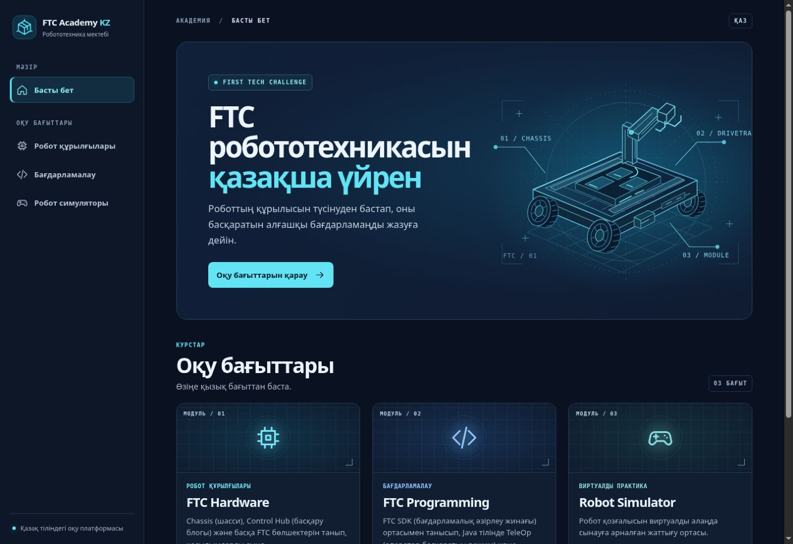
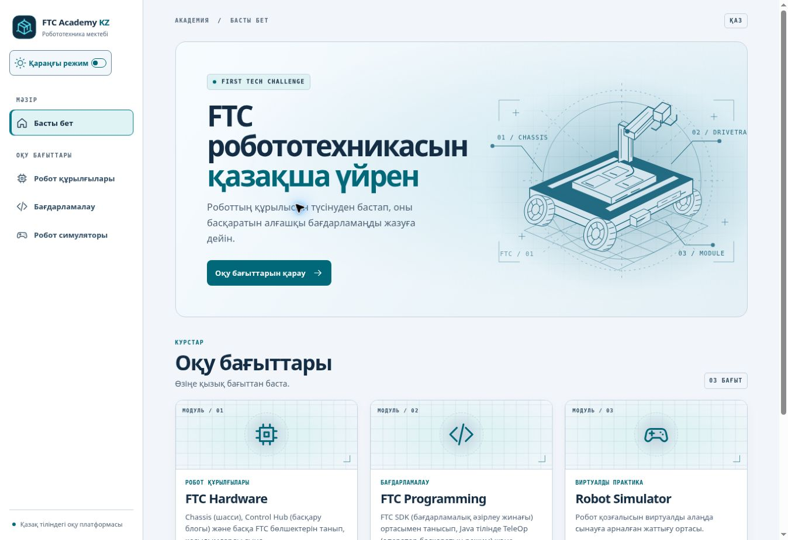
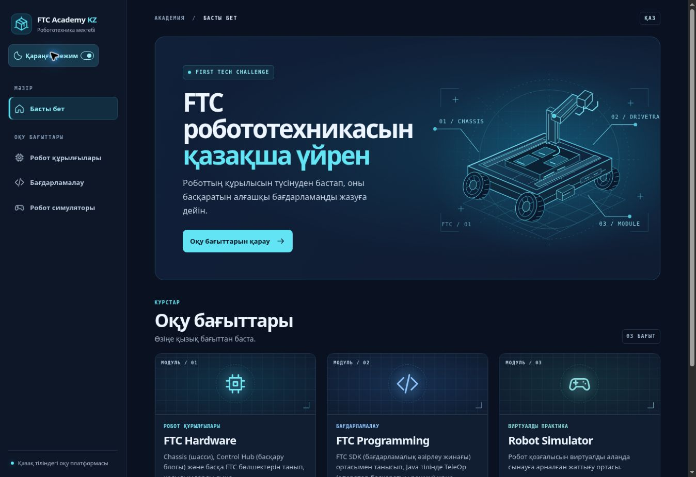
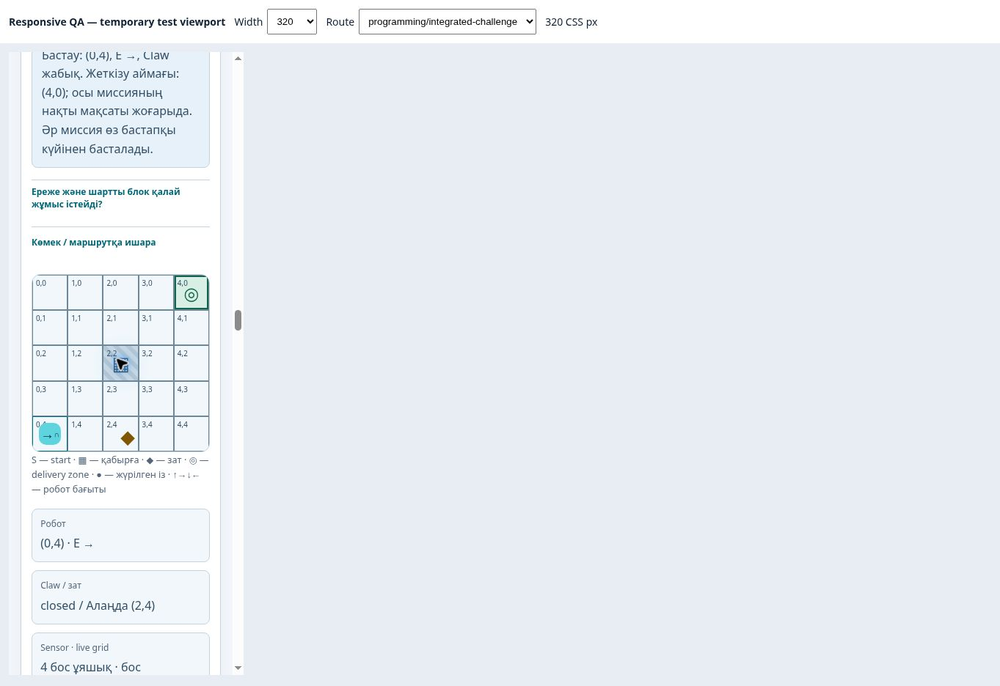
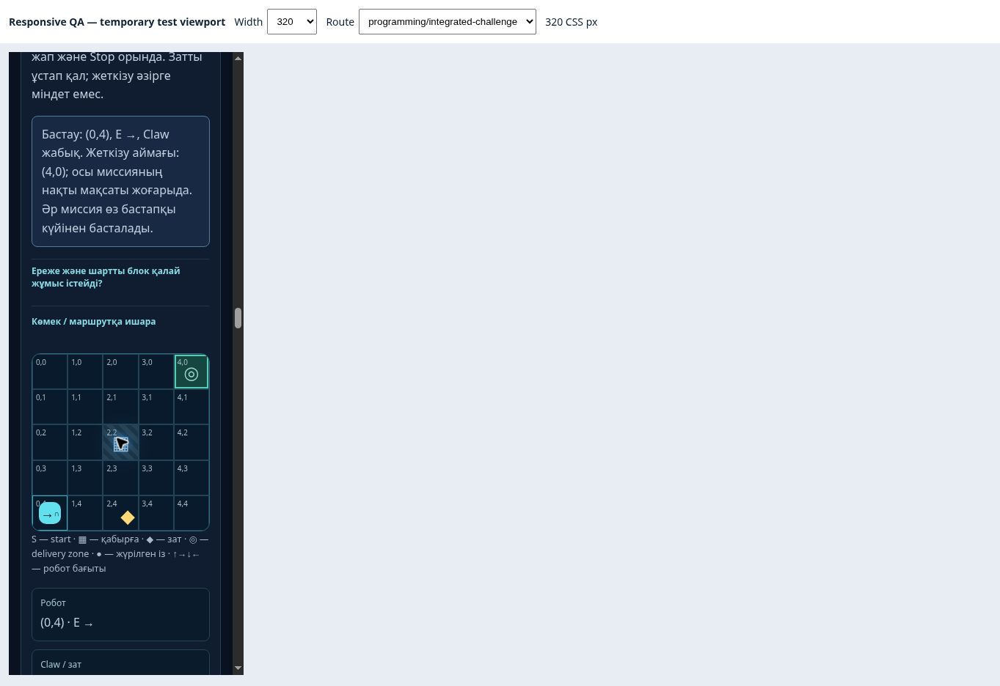

# Light / Dark Mode

Implemented from `main` at `afa50e9734395897131e4086043b0a910f242715`, including PR #11's
Wiring focus correction and PR #12's responsive layout fixes. Date: 2026-11-16.

## Behavior and maintenance

- Light is the default regardless of OS preference. Only the exact stored string `dark`
  selects Dark Mode; missing, malformed or inaccessible storage falls back to Light.
- The sidebar's Sun/Moon switch has the stable visible/accessible name **Қараңғы режим**.
  `aria-checked=true` means Dark Mode. The icon and track also show its state. Native
  button semantics support click, Enter and Space; the hit area is at least 44 px high.
- The only preference key is **`ftc-academy:theme:v1`**. Saving is best-effort: an exception
  does not prevent switching. No progress keys are read, written, migrated or cleared by
  the theme module. Storage events synchronize theme preferences between documents.
- The small head script in `index.html` applies the preference before React/styles are
  painted when the normal script loading path is available. `theme.ts` applies the same
  rules at runtime. Both update `data-theme`, native `color-scheme` and `theme-color`.
- Theme changes re-render the existing App; they do not change the current route or
  remount a lesson deliberately. All educational/scoring/simulation code is unchanged.

`src/theme.css` owns the semantic Light palette: surfaces, text, borders, controls, code,
status feedback and diagram/mission colors. All ten existing stylesheets consume these
roles. Motor Lab's SVG presentation attributes use the same roles; only colors changed.
The homepage's light SVG uses the original geometry with a readable light palette; the
original dark SVG is untouched.

Dark Mode intentionally preserves each existing component's original color as a `var()`
fallback, rather than flattening its navy/cyan variants into one new color. The dark
selector sets the semantic roles to `initial`, the guaranteed-invalid custom-property
value, which activates those fallbacks. This is standard CSS custom-property behavior:
[CSS Variables specification](https://www.w3.org/TR/css-variables-1/#guaranteed-invalid).
There is one central palette, not a separate sheet of per-selector light overrides.

For a new component, use a semantic role and an explicit dark fallback:

```css
.example-panel {
  background: var(--panel-bg, #101c2f);
  color: var(--text-primary, #edf5ff);
}
```

Add a role to both theme selectors if no existing role fits. The theme regression test
checks use-site fallbacks so a missing fallback cannot silently invalidate a dark style.
`--panel-shadow` has explicit values in both modes. Focus remains visible in both themes;
no theme animation was added. Existing reduced-motion behavior is retained.

## Actual verification

| Check | Result and scope |
| --- | --- |
| Default, malformed and blocked/quota-limited storage | PASS — Node tests, including a throwing storage getter |
| Head bootstrap versus runtime preference rules | PASS — Node VM executes the actual inline script against a document stub; this is not a paint/flicker measurement |
| Theme root, native scheme and browser metadata | PASS — unit tests and actual Chromium DOM observations |
| Saved Light and Dark after reload | PASS — actual Chromium, both modes |
| Lesson progress across switching/reload | PASS — actual Integrated lesson summary retained; unit tests preserve the existing model keys/legacy records and write only the theme key |
| Mouse and keyboard switching | PASS — actual desktop and 320 px frame clicks, Enter and Space, checked state and visible focus |
| Switching on every route | PASS — actual switch activation on all 15 routes, including Hardware Wiring/Quiz, overview and every lesson |
| Responsive geometry in both themes | PASS — 15 routes × 4 widths × 2 themes = 120 state-checked cases; no document horizontal overflow or clipped control contents detected |
| Mobile menu coexistence | PASS — 320 px open, switch theme while menu stays open, Escape closes menu |
| QA-01 regression | PASS — Light Mode: DC Motor → Motor 0 → Tab to clear-all → Enter; all cables cleared, DC Motor focused with visible outline, next Tab Motor Encoder |
| Quiz feedback | PASS — actual wrong-answer explanation and correct-answer label remain visible across theme switching; meaning is not color-only |
| Dark palette preservation | PASS within sampled existing styled components — foreground/background/gradient/border/fill/stroke records compared across all 15 routes; new switch and hidden native control UA styles excluded |
| Text contrast | PASS within sampled solid-background text — 2,449 Light text records across 15 routes had no AA threshold failures; sampled Dark text also had none. Gradients, hidden/decorative content and disabled controls excluded |
| Semantic palette contrast | PASS — unit tests check normal text pairs ≥4.5:1 and meaningful UI/diagram boundary pairs ≥3:1, plus representative preserved dark pairs |
| Build/checks | PASS — 119/119 tests; typecheck, production build and diff check |

Responsive tests used the actual app inside a temporary same-origin Chromium iframe at
320, 390, 768 and 1440 CSS px. Classic scrollbars reduce document client width by 15 px.
The 1440 px frame exceeded the outer browser's visible width, so that size was checked
using DOM geometry. Desktop screenshots use the browser's actual visible viewport;
Mission screenshots show the 320 px frame. The temporary harness is absent from the
commit and final production build. An initial long browser batch timed out; it was
discarded and rerun in shorter batches that asserted the active theme before measuring.

The final production build has main JS **674.28 kB / 184.15 kB gzip**, CSS **49.89 kB /
11.61 kB gzip**. The existing >500 kB bundle warning remains; no bundle splitting or
dependencies were introduced. Screenshots below are documentation only, not runtime assets.

### Screenshots

Before (the application previously had only the dark appearance):



After, Light Mode:



After, preserved Dark Mode:



Mission Lab in both themes, 320 px frame:





## Limits

This is not a formal accessibility certification. Gradient/image compositing, every
possible dynamic state and disabled-control contrast were not exhaustively measured.
The initial paint was not recorded with a filmstrip. Physical touch devices, Safari,
Firefox, screen reader, forced-colors/high-contrast settings, browser zoom/text enlargement
and cross-tab synchronization were not manually tested. Existing lesson unit tests pass;
every assessment and mission was not manually replayed during this theme-only change.
Hosted Vercel preview interactions are separate from the local browser checks above.
